# Práctica 04
## 🗃️ Gestor de Archivos Multiplataforma

#### Moreno Noguerón Ximena
#### 2024630201
#### 7CV4 - Aplicaciones Móviles Nativas
#### Profesor Gabriel Hurtado Avilés
#### Fecha de entrega 05 de Noviembre 2026

---

## Objetivo

> Desarrollo de una aplicación móvil **multiplataforma** para la implementación de **almacenamiento local, lectura, escritura, persistencia y visualización de archivos de distintos formatos**, además de la implementación de dichas funcionalidades dentro de un entorno de juego móvil.

## Requisitos de la práctica

- Aplicación funcional sin conexión a internet.
- Aplicación funcional en Android e iOS.
- Compatibilidad mínima con Android 7.0 (API 24) e iOS 15 o superior.

---

## Índice

1. [Estructura de archivos](#estructura-de-archivos)
2. [Tecnología y versiones](#tecnología-y-versiones)
3. [Dependencias](#dependencias)
4. [Compilación y ejecución](#compilación-y-ejecución)
5. [Introducción](#introducción)
6. [Gestor de Archivos Multiplataforma](#gestor-de-archivos-multiplataforma)
7. [Juego con Gestión de Archivos](#juego-con-gestión-de-archivos)
8. [Implementación](#implementación)
9. [Capturas de pantalla](#capturas-de-pantalla)
10. [Pruebas realizadas](#pruebas-realizadas)
11. [Matriz de pruebas](#matriz-de-pruebas)
12. [Resultados](#resultados)
13. [Aprendizajes y dificultades](#aprendizajes-y-dificultades)
14. [Conclusiones](#conclusiones)
15. [Referencias](#referencias)

---

## Estructura de archivos

```text
Practica04/
├── README.md             ← actual
├── gestorarchivos/       ← Parte 1: gestor de archivos multiplataforma
│   ├── lib/
│   │   ├── almacenamiento/   fuentes de archivos (local, SAF, iOS), carpetas autorizadas, caché, errores
│   │   ├── app/              tema Guinda/Azul, ajustes, recientes y favoritos
│   │   ├── modelos/          EntradaArchivo (archivo o carpeta con sus metadatos)
│   │   ├── pantallas/        inicio, explorador y visor
│   │   ├── visores/          resaltado JSON/XML, visor de código, acciones del sistema
│   │   └── widgets/          breadcrumbs, miniaturas, diálogos, detalles
│   ├── android/              objetivo Android (manifiesto sin permisos amplios)
│   └── ios/                  objetivo iOS (canal Swift para carpetas en AppDelegate.swift)
├── misteriogranja/       ← Parte 2: juego "Misterio en la Granja"
│   ├── lib/
│   │   ├── app/              tema, opciones persistentes, sonidos y vibración
│   │   ├── juego/            historia, modelo de partida y motor de reglas
│   │   │   └── archivos/     serializadores JSON/XML/TXT y repositorio de partidas
│   │   ├── pantallas/        inicio, juego (mapa, tablero, bitácora), final, partidas, opciones
│   │   ├── visores/          visor de código reutilizado del gestor
│   │   └── widgets/          fondo animado, retratos de animales, ventanas
│   ├── assets/sonidos/       efectos de sonido .wav
│   ├── test/                 36 pruebas automáticas
│   ├── android/
│   └── ios/
└── docs/
    └── capturas/
        ├── android/          evidencias en Android
        └── ios/              evidencias en iOS
```

---

## Tecnología y versiones

Se eligió **Flutter (Dart)** para ambas partes: una sola base de código con interfaz compartida y código específico por plataforma solo donde el sistema lo exige (como el acceso a carpetas en iOS).

| Elemento | Versión |
|---|---|
| Flutter | 3.47.2 |
| Dart | 3.13.2 |
| Android — SDK mínimo | API 24 (Android 7.0) |
| Android — compileSdk / targetSdk | 36 |
| Android Gradle Plugin / Kotlin / Gradle | 9.1.0 / 2.4.0 / 9.3.1 |
| Java (JDK) | 17 |
| iOS — versión mínima (deployment target) | 15.0 |
| Xcode | 27.0 |
| IDE | Android Studio (Windows 11) y Xcode (macOS) |

**Sistemas en los que se probó:**

| Sistema | Dispositivo / simulador | Versión del sistema |
|---|---|---|
| Android | Samsung Galaxy A15 (SM-A155M) | Android 16 |
| iOS | iPhone 15 Pro | iOS 26.6,2 |

---

## Dependencias

Todas funcionan sin conexión a Internet.

### Gestor de archivos (`gestorarchivos`)

| Paquete | Versión | Uso |
|---|---|---|
| `path_provider` | 2.1.6 | Carpetas propias de la app (documentos y temporales) |
| `path` | 1.9.1 | Manejo de rutas y extensiones |
| `shared_preferences` | 2.5.6 | Tema, recientes, favoritos y carpetas autorizadas (SharedPreferences / NSUserDefaults) |
| `file_picker` | 13.3.2 | Selector de carpetas del sistema y "Guardar como" para exportar |
| `saf_util` | 3.1.1 | Android: Storage Access Framework (elegir carpeta, listar, copiar, mover, renombrar, eliminar) |
| `saf_stream` | 4.0.3 | Android: leer y escribir el contenido de documentos SAF |
| `share_plus` | 13.3.1 | Compartir archivos con la hoja del sistema |
| `open_filex` | 5.0.0 | Abrir formatos no soportados con otra app |
| `mime` | 2.1.0 | Tipo MIME de cada archivo |
| `xml` | 7.1.0 | Formatear (pretty print) archivos XML |

### Juego (`misteriogranja`)

| Paquete | Versión | Uso |
|---|---|---|
| `path_provider` | 2.1.6 | Carpeta privada donde se guardan las partidas |
| `path` | 1.9.1 | Nombres y extensiones de archivo |
| `shared_preferences` | 2.5.6 | Opciones del jugador (tema, formato, dificultad, sonido, nombre) |
| `xml` | 7.0.1 | Leer y escribir partidas en XML |
| `file_picker` | 13.3.2 | Importar partidas y exportar una copia donde elija el usuario |
| `share_plus` | 13.3.1 | Compartir partidas |
| `audioplayers` | 6.8.1 | Efectos de sonido |
| `flutter_svg` | 2.3.2 | Incluido en el proyecto; las ilustraciones finales se dibujan con `CustomPainter` |

Dependencias de desarrollo en ambos proyectos: `flutter_test` y `flutter_lints` 6.0.0.

---

## Compilación y ejecución

### Requisitos

1. Instalar **Flutter 3.47.2** y agregarlo al `PATH`. Verificar con `flutter doctor`.
2. Clonar el repositorio y entrar a la carpeta de la app que se quiera ejecutar:
   ```bash
   cd Practica04/gestorarchivos      # o Practica04/misteriogranja
   flutter pub get
   ```

### Android

1. Instalar **Android Studio** con el Android SDK (plataforma 36), el plugin de Flutter y el JDK 17.
2. En el teléfono: activar **Opciones de desarrollador → Depuración USB** y conectarlo por cable (o crear un emulador con API 24 o superior en *Device Manager*).
3. Ejecutar:
   ```bash
   flutter devices          # confirmar que aparece el teléfono
   flutter run              # modo depuración
   flutter build apk        # APK de lanzamiento en build/app/outputs/flutter-apk/
   ```
   También se puede abrir la carpeta de la app en Android Studio y presionar ▶ **Run**.
4. Pruebas automáticas del juego: `flutter test` (dentro de `misteriogranja`).

### iOS (macOS con Xcode)

1. **Preparar Xcode:**
   ```bash
   # Instalar Xcode desde la App Store y luego:
   sudo xcode-select --switch /Applications/Xcode.app/Contents/Developer
   sudo xcodebuild -runFirstLaunch
   sudo xcodebuild -license accept
   ```
   En **Xcode → Settings → Components**, descargar el runtime de **iOS** para el simulador.
2. Si `flutter doctor` lo pide, instalar CocoaPods: `brew install cocoapods`.
3. Verificar el entorno con `flutter doctor` (la sección *Xcode* debe aparecer en verde).
4. **En el simulador:**
   ```bash
   open -a Simulator
   flutter devices                  # copiar el nombre del simulador
   flutter run -d "iPhone 16"       # usar el nombre que aparezca en tu equipo
   ```
5. **En un iPhone real:** abrir `ios/Runner.xcworkspace` en Xcode → *Runner* → **Signing & Capabilities** → elegir un **Team** (basta un Apple ID personal) y, si se requiere, cambiar el *Bundle Identifier* por uno único. Conectar el iPhone, activar el **Modo desarrollador** (Ajustes → Privacidad y seguridad) y ejecutar con ▶. La primera vez, confiar en el certificado en *Ajustes → General → VPN y gestión de dispositivos*.
6. Ambos proyectos ya tienen `IPHONEOS_DEPLOYMENT_TARGET = 15.0`, y en `Info.plist` las claves `UIFileSharingEnabled` y `LSSupportsOpeningDocumentsInPlace`, para que los archivos de la app sean visibles en la app **Archivos**.

---

## Introducción

Se desarrollaron dos aplicaciones Flutter que funcionan **100 % sin conexión** en Android e iOS:

1. **Gestor de archivos:** explora el espacio propio de la app y las carpetas que el usuario autoriza con el selector del sistema (SAF en Android, selector de documentos en iOS). Abre texto, Markdown, JSON y XML (con resaltado de sintaxis) e imágenes (con zoom y rotación). Muestra metadatos, copia, mueve, renombra y elimina, y guarda recientes, favoritos y una caché de miniaturas.
2. **Misterio en la Granja:** juego de detectives original. Don Chema, un granjero, investiga durante dos noches qué animal se come su maíz. Cada partida se guarda sola en **TXT, XML o JSON** (a elección del jugador), se puede continuar después de cerrar la app y se administra desde una pantalla de partidas guardadas con metadatos, etiquetas, exportación, compartir e importación con validación.

Ambas apps implementan los temas **Guinda (IPN)** y **Azul (ESCOM)**, que se adaptan al modo claro u oscuro del sistema. El juego agrega además un tema **Granja**, propio del juego.

---

## Gestor de Archivos Multiplataforma

> Implementación de almacenamiento local, lectura, escritura, persistencia y visualización de archivos.

| Requisito del PDF | Cómo se cumple |
|---|---|
| Explorar el espacio propio y carpetas elegidas por el usuario | *Almacenamiento local* (carpeta de documentos de la app) y **carpetas autorizadas** con el selector del sistema: SAF en Android y selector de documentos con *bookmarks* de seguridad en iOS |
| Estructura de carpetas sin acceso irrestricto | Solo se listan la carpeta propia y las autorizadas; el manifiesto **elimina** los permisos amplios (`READ_EXTERNAL_STORAGE`, `READ_MEDIA_*`) que agregaba una dependencia |
| Texto, JSON y XML | Visor con formato (pretty print) y **resaltado de sintaxis propio** para JSON y XML; si el archivo es inválido, se muestra el texto original con un aviso |
| Imágenes con zoom y rotación | `InteractiveViewer` (pellizcar para hacer zoom), botón para rotar 90° y doble toque para restablecer |
| Formatos no soportados | Diálogo para **abrir con otra app**, **compartir** o **exportar** |
| Metadatos | Nombre, tipo MIME, tamaño, fechas de modificación y de creación, y ubicación; si un dato no está disponible, se muestra "No disponible" |
| Temas Guinda / Azul con modo del sistema | `ColorScheme.fromSeed` con color semilla de cada tema y `ThemeMode.system` |
| Interfaz responsiva | El explorador cambia de lista a cuadrícula en pantallas anchas (600 px o más: tabletas u horizontal) y el usuario puede elegir la vista |
| Breadcrumbs | Barra de ruta desplazable; cada segmento lleva a esa carpeta |
| Recientes y favoritos persistentes | `shared_preferences` (JSON): 15 recientes y favoritos ilimitados |
| Caché de miniaturas | Memoria (LRU de 150 entradas) más disco (carpeta temporal), con imágenes reducidas a 160 px |
| Copiar, mover, renombrar, eliminar | Con confirmación en las acciones destructivas y validación del nombre y del destino |
| Errores sin bloquear la app | `ErrorArchivo` traduce los errores del sistema (no existe, permiso denegado, sin espacio, solo lectura) a mensajes legibles |

---

## Juego con Gestión de Archivos

> Implementación de las funcionalidades previamente desarrolladas dentro de un entorno de juego móvil.

### Historia y mecánica

Alguien se está comiendo el maíz de **Don Chema** (el nombre del granjero se puede cambiar). Hay **6 sospechosos**: el perro, el conejo, el zorro, el tlacuache, el cacomixtle y el mapache. El jugador:

1. **Viaja** por el mapa de la granja (cada viaje cuesta 15 minutos de la noche).
2. **Busca** en los puntos de cada lugar (30 minutos). Algunos tienen pistas y algunas pistas son **engañosas**.
3. En el **tablero de sospechosos**, **asigna pistas** a cada animal y lo **descarta** solo si tiene una pista que lo demuestre.
4. **Acusa** al culpable con al menos una pista que lo señale.

| | Noche 1 (nivel 1) | Noche 2 (nivel 2) |
|---|---|---|
| Lugares | La casa y el maizal | El granero y el área libre |
| Objetivo | Descartar al perro, al conejo y al zorro (de 6 a 3 sospechosos) | Descartar a 2 de los 3 restantes y acusar al culpable |

**Modos de juego:**
- **Aprendiz:** sin límite de tiempo; los puntos con pista se resaltan y los errores traen ayuda.
- **Detective:** la noche termina a las 03:00 y el tiempo sobrante da puntos.

**Puntuación:**

| Acción | Puntos |
|---|---|
| Pista encontrada | +50 |
| Descarte correcto | +30 |
| Error (descartar sin prueba o acusar mal) | −40 |
| Noche resuelta | +100 |
| Cada media hora que sobra | +10 |
| "Deducción pura" (resolver sin el testimonio de Don Tecolote) | +80 |

Al final se muestra un **rango**: Ayudante de detective, Detective o Detective maestro.

**Efectos visuales y sonoros:** el cielo se oscurece conforme avanza la noche, la milpa se mece y de noche hay luciérnagas. El granjero camina entre lugares y las ventanas de pista aparecen con rebote. Los animales están dibujados con código; se ven en gris cuando se descartan y el culpable se revela de silueta a color. La puntuación se anima y hay 6 sonidos (`clic`, `paso`, `pista`, `descarte`, `error`, `victoria`) con vibración, que se pueden desactivar en Opciones.

### Gestión de archivos del juego

| Requisito del PDF | Cómo se cumple |
|---|---|
| Guardar en TXT, XML y JSON | Tres serializadores que parten del mismo modelo (ver [Implementación](#serialización-txt-xml-y-json)) |
| Elegir el formato preferido | *Opciones → Formato de guardado* |
| Cargar desde cualquiera de los tres | *Continuar partida*, *Partidas guardadas → Continuar* e *Importar* |
| Información guardada | Estado del juego (noche, hora, lugar, pistas, puntos revisados, estado de cada sospechoso, pistas asignadas, acusado), puntuación, **tiempo transcurrido** (segundos reales jugados y hora dentro del juego), **configuraciones personalizadas** (dificultad y nombre del granjero) e **historial de movimientos** (la bitácora) |
| Lista con metadatos | Nombre, fecha, formato, tamaño, estado (en curso, resuelta o sin resolver), noche y hora, puntos, dificultad y etiquetas |
| Etiquetar partidas | Etiquetas sugeridas (Favorita, Para el reporte, Difícil, Rápida) y personalizadas |
| Exportar o compartir | **Exportar una copia** en cualquiera de los tres formatos al lugar que elija el usuario y **compartir** con la hoja del sistema |
| Menú de opciones | Formato de guardado, partidas guardadas, aspecto (tema) y jugabilidad (dificultad, nombre, sonido, vibración) |
| Ver el contenido de los archivos | *Partidas guardadas → Ver el contenido del archivo* (JSON y XML con resaltado) y *Leer la bitácora* |
| Almacenamiento privado | Carpeta `partidas/` dentro de los documentos de la app |
| Persistencia robusta | **Autoguardado** después de cada jugada, al mandar la app al fondo y al salir; escritura **atómica** |
| Archivos vacíos, incompletos o corruptos | Mensaje legible con la causa (y el número de línea en TXT); el archivo dañado aparece marcado en la lista sin afectar a las demás partidas y una importación inválida no se copia |

---

## Implementación

### Arquitectura compartida

Las dos apps siguen la misma organización por capas. La interfaz no toca archivos directamente: pide las operaciones a una capa de almacenamiento y las pantallas se redibujan cuando un `ChangeNotifier` avisa de un cambio.

```text
GESTOR
 Pantallas (inicio, explorador, visor)
      │ usan
 FuenteArchivos  ◄── interfaz común: listar, leer, crear carpeta, copiar, mover, renombrar, eliminar
   ├── FuenteLocal   dart:io sobre la carpeta propia o una carpeta autorizada en iOS
   └── FuenteSaf     Android SAF (content://) con saf_util / saf_stream
 Ajustes · Historial (recientes/favoritos) · CarpetasAutorizadas · CacheMiniaturas
      │ persisten en
 shared_preferences  (SharedPreferences en Android, NSUserDefaults en iOS)

JUEGO
 Pantallas (mapa, tablero, bitácora, final, partidas, opciones)
      │ llaman jugadas                ▲ notifyListeners()
 MotorJuego (reglas, puntos, tiempo) ─┘
      │ modifica                       │ escucha
 EstadoPartida + Evento (modelo)    AutoGuardado
      │ toMap() / fromMap()            │
 Serializador JSON · XML · TXT  ◄── RepositorioPartidas ──► Documents/partidas/<id>.<ext>
```

- **Historia (`datos_historia.dart`):** todo el contenido (lugares, sospechosos, pistas y textos) está separado del código de las reglas.
- **Motor (`motor.dart`):** cada jugada valida la acción, actualiza el estado, suma o resta puntos, **anota un evento en el historial** y devuelve un `Resultado` que la pantalla convierte en mensaje, sonido y vibración.
- **Código reutilizado del gestor en el juego:** el visor de código con resaltado, el diálogo de nombres, las acciones de compartir y exportar, y los mensajes de estado.

### Código específico de Android e iOS

| | Android | iOS |
|---|---|---|
| Carpetas del usuario | **Storage Access Framework**: `ACTION_OPEN_DOCUMENT_TREE` con permiso persistente (`saf_util`), lectura y escritura con `saf_stream` | **Canal nativo propio** `gestorarchivos/carpetas_ios` en `AppDelegate.swift`: `UIDocumentPickerViewController` en modo carpeta, `startAccessingSecurityScopedResource()` y **bookmark** de seguridad guardado para reabrir la carpeta después |
| Permisos | Sin permisos de almacenamiento global; el manifiesto quita con `tools:node="remove"` los que agregaba `open_filex` | Sandbox de la app; solo ubicaciones elegidas en el selector |
| Exportar | "Crear documento" de SAF (`FilePicker.saveFile`) | Selector de Archivos (`FilePicker.saveFile`) |
| Compartir | Hoja de compartir de Android | Hoja de compartir de iOS (en iPad se indica el punto de origen) |
| Archivos propios visibles | No (almacenamiento privado) | Sí, en la app **Archivos** (`UIFileSharingEnabled`) |

El canal de iOS fue necesario porque `getDirectoryPath()` de `file_picker` no conserva el permiso de acceso a la carpeta elegida. Sin el bookmark, la carpeta deja de poder leerse al cerrar la app.

### APIs de acceso a archivos

- **`path_provider`:** `getApplicationDocumentsDirectory()` (espacio propio y partidas) y `getTemporaryDirectory()` (caché de miniaturas).
- **`dart:io`:** `File` y `Directory` para leer, escribir, listar y obtener metadatos (`stat`).
- **Android SAF:** URIs `content://`, permiso persistente por carpeta y operaciones del proveedor de documentos.
- **iOS:** `UIDocumentPickerViewController`, URLs con alcance de seguridad y bookmarks.
- **Escritura segura de partidas:** se escribe primero un archivo `.tmp` y después se renombra sobre el definitivo. Si la app se cierra a la mitad, el archivo anterior queda intacto. Además, las escrituras se encolan para que nunca haya dos al mismo tiempo.

### Serialización TXT, XML y JSON

Los tres formatos parten del mismo **mapa canónico** (`EstadoPartida.toMap()`). Al leer, cada formato vuelve a armar ese mapa y `EstadoPartida.fromMap()` **valida todo en un solo lugar**: campos obligatorios, rangos, ids de lugares, pistas y sospechosos existentes, y pistas asignadas que de verdad se encontraron. Acepta números y booleanos escritos como texto, que es como llegan de XML y TXT. Cualquier problema se reporta como `ErrorPartida` con un mensaje legible.

**JSON:** el mapa tal cual, con sangría.
```json
{
  "version": 1,
  "nombre": "Investigación de Don Chema",
  "nivel": 1,
  "puntuacion": 80,
  "configuracion": { "dificultad": "aprendiz", "granjero": "Don Chema" },
  "sospechosos": [ { "id": "perro", "estado": "descartado", "pistas": ["coartada_perro"] } ],
  "historial": [ { "nivel": 1, "minuto": 30, "tipo": "pista", "lugar": "casa", "texto": "…" } ]
}
```

**XML:** los datos simples son etiquetas y los sospechosos y eventos guardan sus datos como atributos (paquete `xml`).
```xml
<partida version="1">
  <nombre>Investigación de Don Chema</nombre>
  <puntuacion>80</puntuacion>
  <configuracion><dificultad>aprendiz</dificultad><granjero>Don Chema</granjero></configuracion>
  <sospechosos><sospechoso id="perro" estado="descartado"><pista>coartada_perro</pista></sospechoso></sospechosos>
  <historial><evento nivel="1" minuto="30" tipo="pista" lugar="casa">…</evento></historial>
</partida>
```

**TXT (bitácora):** se lee como un cuento y también se puede volver a cargar. Tiene tres secciones; las líneas con `#` son comentarios.
```text
# Misterio en la Granja — bitácora de la partida
nombre: Investigación de Don Chema
puntuacion: 80
terminada: no
--- SOSPECHOSOS ---
perro | descartado | coartada_perro
--- BITÁCORA ---
== Noche 1 ==
22:30 | casa | pista:coartada_perro | En «Cama del perro», Don Chema encontró una pista…
22:45 | maizal | viaje | Don Chema caminó hasta el maizal.
```

---

## Capturas de pantalla

Guardar las imágenes en `docs/capturas/android/` y `docs/capturas/ios/` con los nombres indicados.

### Gestor de archivos

| Captura | Android | iOS |
|---|---|---|
| Inicio, tema Guinda, modo claro |  |  |
| Inicio, tema Guinda, modo obscuro |  |  |
| Tema Azul, modo oscuro | 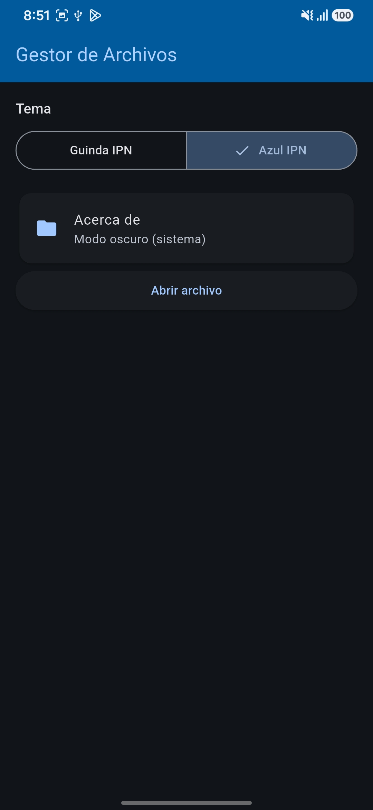 |  |
| Tema Azul, modo claro |  |  |
| Explorador con breadcrumbs | 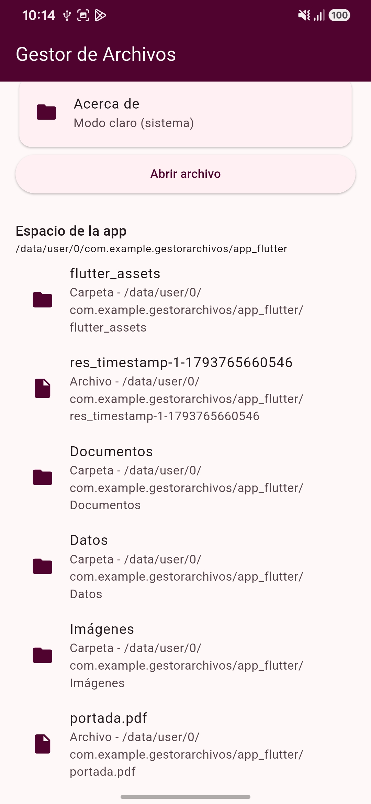 |  |
| Carpeta autorizada (selector del sistema) | 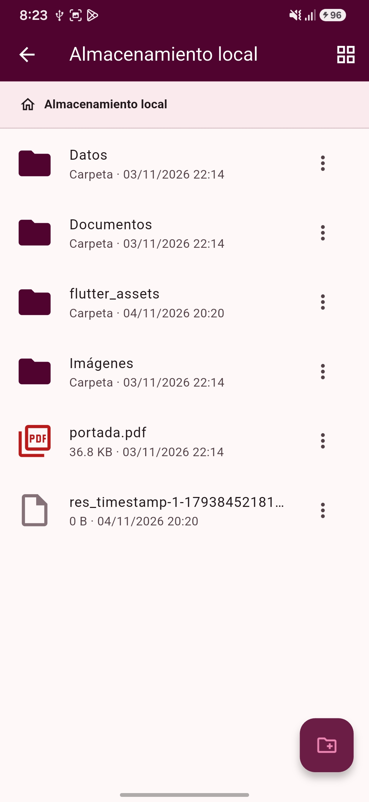 |  |
| Metadatos | 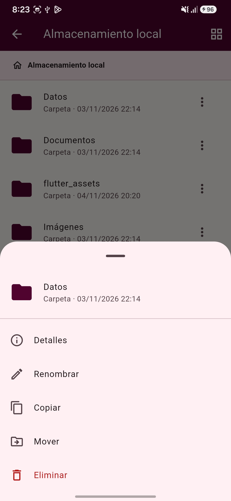 |  |
| Permisos carpetas autorizadas | 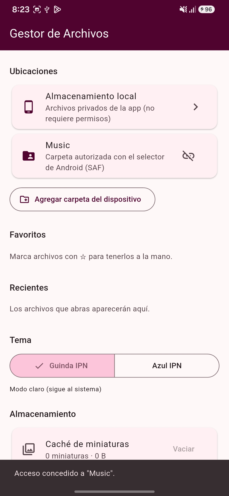 |  |

### Misterio en la Granja

| Captura | Android | iOS |
|---|---|---|
| Inicio (en vertical) | 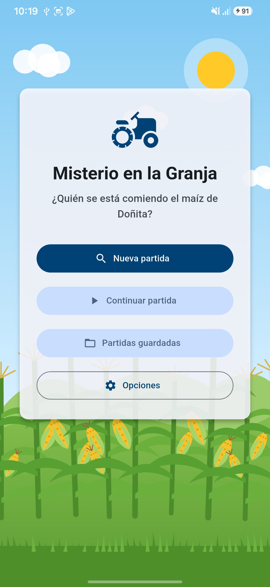 |  |
| Inicio (en horizontal) | 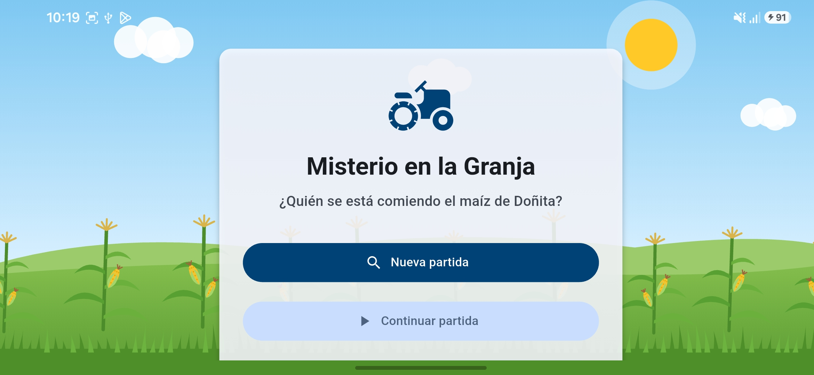 |  |
| Opciones (tema, formato, dificultad) | 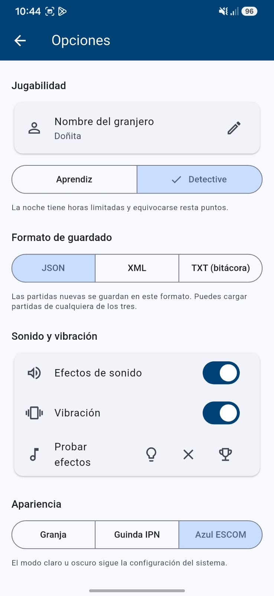 |  |
| Mapa de la noche 1 | 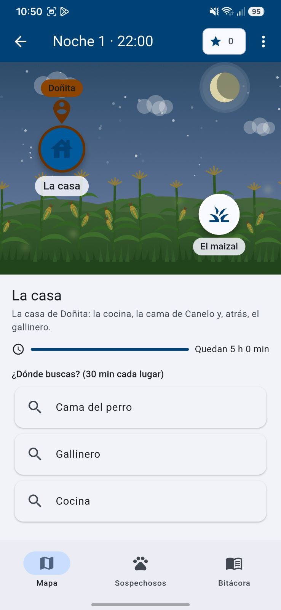 |  |
| Pista encontrada |  |  |
| Tablero de sospechosos | 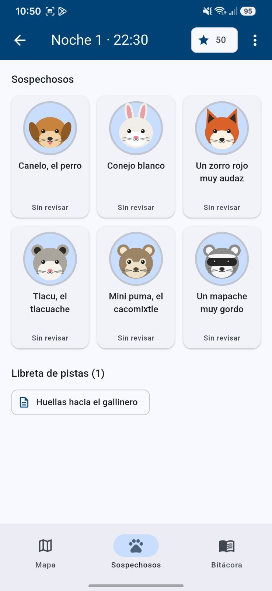 |  |
| Ficha y asignación de pistas | 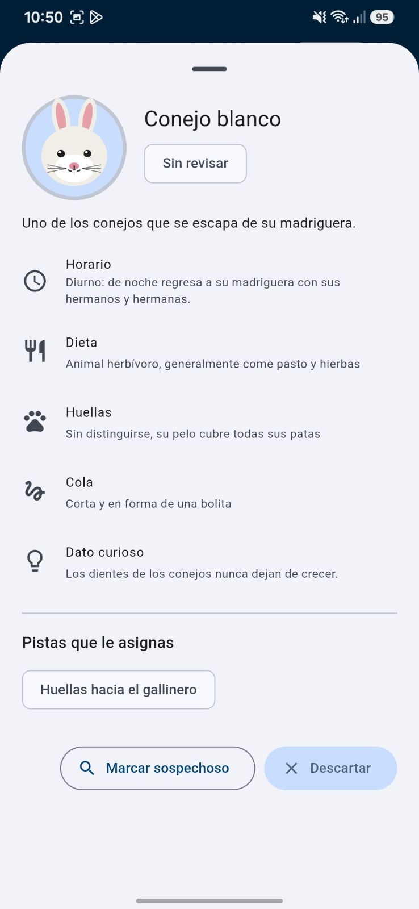 |  |
| Pantalla final | 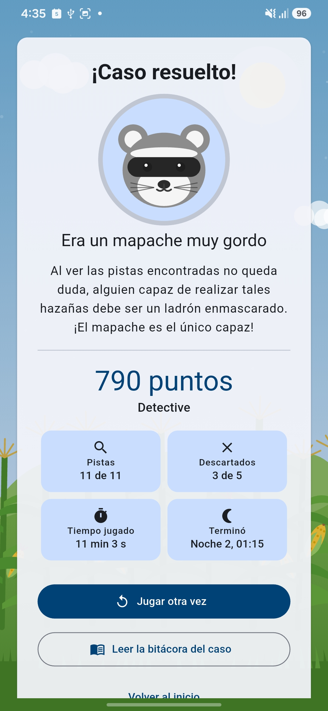 |  |
| Bitácora | 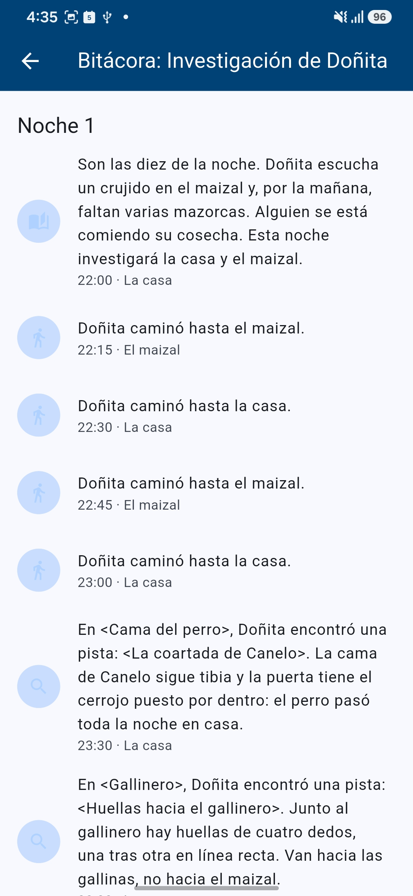 |  |
| Exportar juego | 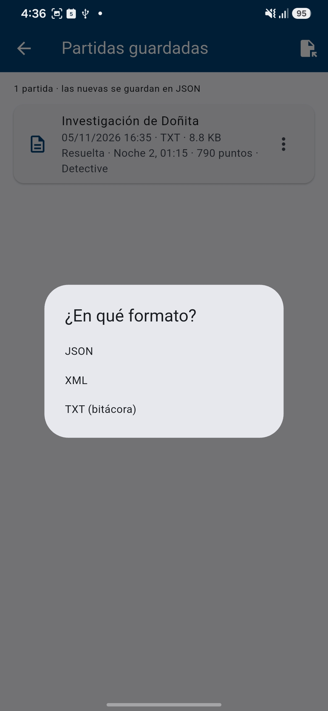 |  |
| Formato exportado juego | 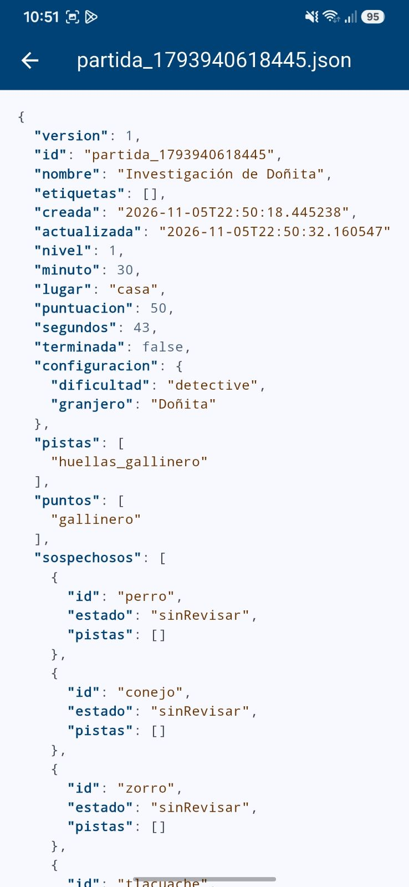 |  |

---

## Resultados

- Las **dos aplicaciones** funcionan sin conexión, con temas Guinda y Azul adaptados al modo del sistema, y con el mismo código para Android e iOS (más un canal nativo en Swift para las carpetas de iOS).
- El gestor accede **solo** a la carpeta propia y a las carpetas que el usuario autoriza, sin permisos amplios de almacenamiento.
- El juego guarda, carga, exporta, comparte e importa partidas en **TXT, XML y JSON**, se recupera después de cerrar la app y detecta archivos dañados con mensajes legibles.
- **36 pruebas automáticas** aprobadas en el juego y análisis estático sin observaciones.

---

## Aprendizajes y dificultades

| Dificultad | Cómo la resolví | Aprendizaje |
|---|---|---|
| La compilación de Android fallaba en Windows porque la caché de Pub (C:) y el proyecto (D:) estaban en unidades distintas | Desactivar la compilación incremental de Kotlin (`kotlin.incremental=false`) | Las herramientas de compilación pueden depender de rutas relativas; leer el registro completo de Gradle ayuda a encontrar la causa real |
| En iOS, la carpeta elegida dejaba de poder leerse al cerrar la app | Canal nativo en Swift con `startAccessingSecurityScopedResource()` y bookmarks de seguridad | El sandbox de iOS exige pedir y conservar el permiso de cada ubicación de forma explícita |
| Un paquete agregaba permisos amplios de almacenamiento | Quitarlos en el manifiesto con `tools:node="remove"` | Revisar el manifiesto final (combinado) y no solo el propio |
| Conflicto de versiones entre `xml` y `flutter_svg` | Ajustar la restricción a `xml: ^7.0.1` | Interpretar los errores de resolución de dependencias de `pub` |
| Una partida podía quedar dañada si la app se cerraba al guardar | Escritura atómica (archivo `.tmp` y renombrar) y una cola de escrituras | La persistencia robusta también depende de *cómo* se escribe, no solo de *qué* |
| Validar tres formatos distintos sin repetir código | Un mapa canónico y una sola validación (`fromMap`) para JSON, XML y TXT | Separar el formato de archivo del modelo de datos simplifica las pruebas |

---

## Conclusiones

Flutter permitió construir dos aplicaciones con una sola base de código y una funcionalidad central equivalente en Android e iOS. Aun así, el acceso a archivos fue la parte donde más se notan las diferencias entre sistemas: Android trabaja con el Storage Access Framework y URIs `content://`, mientras que iOS exige el selector de documentos, URLs con alcance de seguridad y bookmarks. Respetar esas reglas en lugar de pedir permisos amplios hizo las apps más seguras y fue la parte con más aprendizaje técnico.

En el juego, separar la historia, el modelo, el motor de reglas y la capa de archivos facilitó agregar los tres formatos de guardado y probarlos de forma automática, incluidos los archivos dañados. El historial de movimientos sirvió a la vez como bitácora del jugador y como formato TXT legible.

---

## Uso de herramientas de inteligencia artificial

Durante el desarrollo se utilizó **Claude (Anthropic)** para los efectos de sonido (sintetizados con un script de Python), creación de los personajes y el paisaje del juego que se dibujan con código (`CustomPainter`), sin imágenes de terceros.

---

## Referencias

- Anthropic. (2026). *Claude* [Modelo de lenguaje de gran tamaño]. https://claude.ai
- Android Developers. (2026). *Access documents and other files from shared storage*. Google. https://developer.android.com/training/data-storage/shared/documents-files
- Android Developers. (2026). *Data and file storage overview*. Google. https://developer.android.com/training/data-storage
- Apple Inc. (2026). *UIDocumentPickerViewController*. Apple Developer Documentation. https://developer.apple.com/documentation/uikit/uidocumentpickerviewcontroller
- Dart Team. (2026). *Dart documentation*. Google. https://dart.dev/docs
- Flutter Team. (2026). *Flutter documentation*. Google. https://docs.flutter.dev/
- Flutter Team. (2026). *path_provider* (Versión 2.1.6) [Software]. pub.dev. https://pub.dev/packages/path_provider
- Flutter Team. (2026). *shared_preferences* (Versión 2.5.6) [Software]. pub.dev. https://pub.dev/packages/shared_preferences
- Flutter Community. (2026). *share_plus* (Versión 13.3.1) [Software]. pub.dev. https://pub.dev/packages/share_plus
- *file_picker* (Versión 13.3.2) [Software]. (2026). pub.dev. https://pub.dev/packages/file_picker
- *saf_util* (Versión 3.1.1) [Software]. (2026). pub.dev. https://pub.dev/packages/saf_util
- *saf_stream* (Versión 4.0.3) [Software]. (2026). pub.dev. https://pub.dev/packages/saf_stream
- *open_filex* (Versión 5.0.0) [Software]. (2026). pub.dev. https://pub.dev/packages/open_filex
- Renggli, L. (2026). *xml* (Versión 7.1.0) [Software]. pub.dev. https://pub.dev/packages/xml
- Blue Fire. (2026). *audioplayers* (Versión 6.8.1) [Software]. pub.dev. https://pub.dev/packages/audioplayers

---
